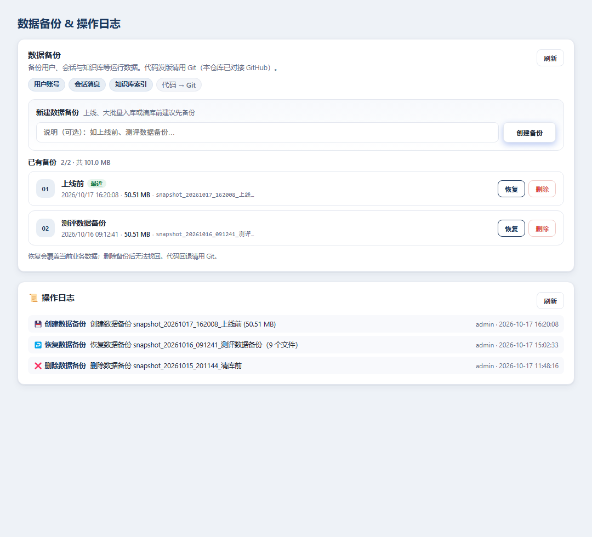

# Legal RAG QA · 法律知识问答助手

> 基于 RAG 检索增强生成的法律知识问答系统，让普通人也能像律师一样快速查到准确法条。

[](https://www.python.org/)
[](https://platform.deepseek.com/)
[](https://dify.ai/)
[](https://streamlit.io/)

---

## 项目简介

普通人遇到法律问题（借钱不还、劳动纠纷、租房押金）时，面临两大痛点：**查法条门槛高**（不知道用哪部法、找不到第几条）、**律师咨询贵**（线下咨询动辄几百起）。

本项目独立从 0 到 1 完成需求定义、RAG 流程搭建、产品设计与全栈开发，构建了一个**回答带法条引用溯源、可点击跳转原文**的法律问答助手。

## 核心数据

| 指标 | 数值 |
|------|------|
| 收录法律法规 | **377 部** |
| 检索切片数 | **26,371 个** |
| 注册用户 | **28 人**（含法律从业者） |
| 真实对话 | **146 条** |
| 开发周期 | ~2 个月 |

## 产品特性

### 核心功能
- **智能问答**：基于 RAG 检索增强生成，回答法律问题并引用具体法条
- **引用溯源**：每条回答附法条出处，可点击跳转至原文位置
- **多轮追问**：支持上下文连续对话，逐步深入问题
- **常识秒回**：非法律类问题快速回复，不走完整 RAG 链路

### 产品设计亮点
- **风险兜底**：顶部常驻 AI 免责声明，回答末尾自动追加"建议咨询专业律师"
- **快捷提问**：首页推荐常见法律问题（劳动合同、宪法权利、违约金等）
- **用户系统**：注册登录、角色权限管理（普通用户/管理员）

### 管理后台
- **数据看板**：用户数、会话数、消息数、文档数、检索块数一目了然
- **用户管理**：搜索、角色分配、用户删除
- **数据备份**：备份并恢复用户、会话与知识库索引。代码发版用 Git
- **操作日志**：完整记录所有管理操作

## 技术架构

```
┌─────────────┐     ┌──────────────┐     ┌─────────────┐
│  Streamlit  │────▶│  DeepSeek API │────▶│  RAG 检索   │
│  前端对话界面 │◀────│  (大模型生成)  │◀────│  (向量数据库) │
└─────────────┘     └──────────────┘     └─────────────┘
        │                                      │
        ▼                                      ▼
┌─────────────┐     ┌──────────────┐     ┌─────────────┐
│  JSON 文件  │     │   用户权限    │     │  法律文档库  │
│  会话持久化  │     │   管理后台    │     │  377部法规   │
└─────────────┘     └──────────────┘     └─────────────┘
```

### 技术栈
- **前端**：React 18 + TypeScript + Vite（Web）
- **后端**：Python + FastAPI
- **大模型（LLM）**：DeepSeek Chat API
- **RAG**：自研检索增强（分块 / 向量检索 / 引用溯源；后续混合检索+重排）
- **业务库**：MySQL 8（任务书硬性要求）
- **向量检索**：本地向量库（开发）/ Qdrant（Docker Compose）
- **部署**：Docker Compose（`deploy/docker-compose.yml`）
- **测试**：pytest + `scripts/smoke_m0.py`

## 快速开始

### 环境要求
- Python 3.10+、Node.js 18+
- DeepSeek API Key
- Docker（可选，用于 MySQL / Qdrant / 全栈 Compose）

### 本机开发（摘要）

```bash
git clone https://github.com/tys0321/legal-rag-qa.git
cd legal-rag-qa

# 基础设施
docker compose -f deploy/docker-compose.yml up -d mysql qdrant

# 配置 .env（DEEPSEEK_API_KEY / MySQL / 向量后端）后：
cd backend && pip install -r requirements.txt
uvicorn app.main:app --reload --port 8000

# 另开终端
cd frontend && npm install && npm run dev
```

完整步骤、Compose 全栈端口与烟测清单见 **[docs/DEPLOY.md](docs/DEPLOY.md)**。

## 项目职责

本项目由一人独立完成全流程：

1. **需求分析**：调研法律问答场景痛点，分析竞品（ChatLaw 等），定义产品方向
2. **数据采集**：编写爬虫采集 377 部现行法律法规文本
3. **RAG 搭建**：设计文档切片策略，基于 Dify 搭建检索增强生成流程
4. **产品设计**：设计引用溯源、多轮对话、风险兜底等交互逻辑
5. **全栈开发**：独立完成前端界面、用户系统、管理后台、数据备份
6. **质量保障**：编写 pytest 测试用例，API 恢复验证

## 目录结构

```
legal-rag-qa/
├── app.py              # Streamlit 主应用
├── pages/
│   ├── chat.py         # 对话页面
│   └── admin.py        # 管理后台
├── data/
│   ├── laws/           # 法律法规原文
│   └── sessions/       # 会话持久化
├── tests/              # pytest 测试用例
└── requirements.txt
```

## 截图

### 主界面


### 问答效果（回答带法条引用溯源）


### 管理后台（数据看板 & 用户管理）


### 数据备份 & 操作日志


### 高保真原型设计稿


## License

MIT License
